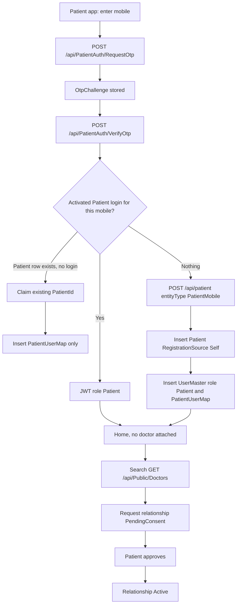
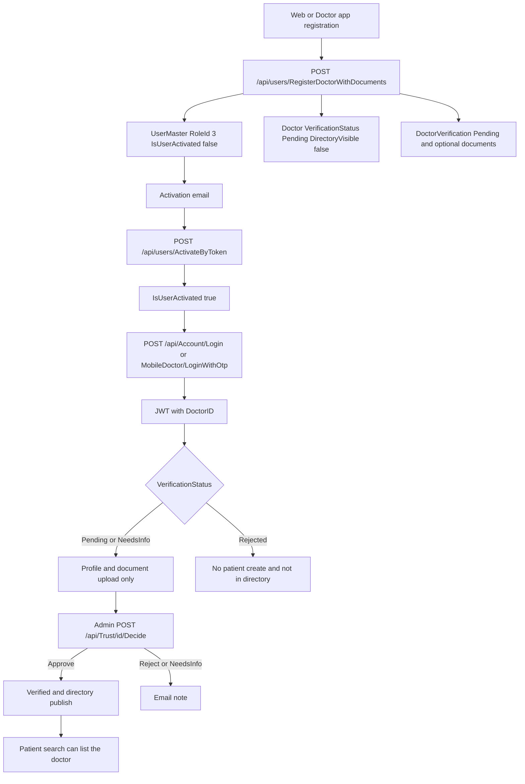
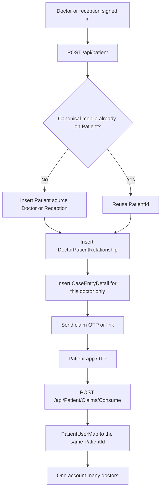
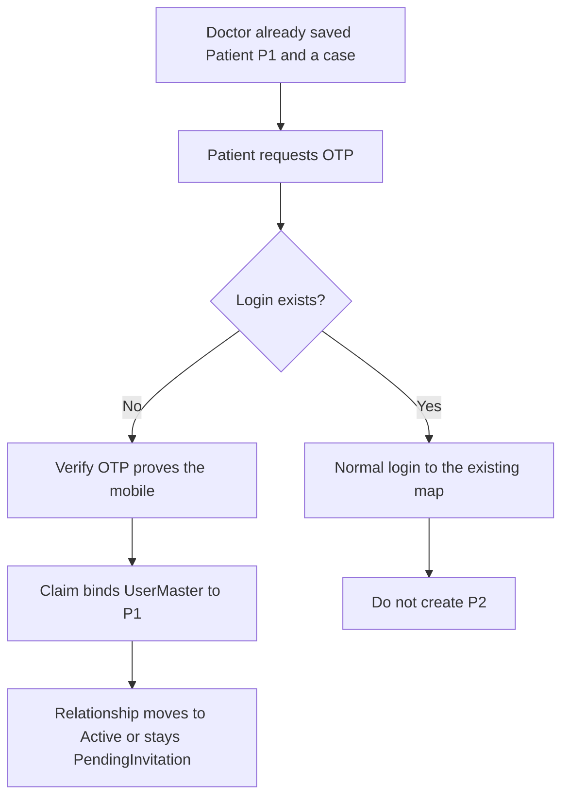
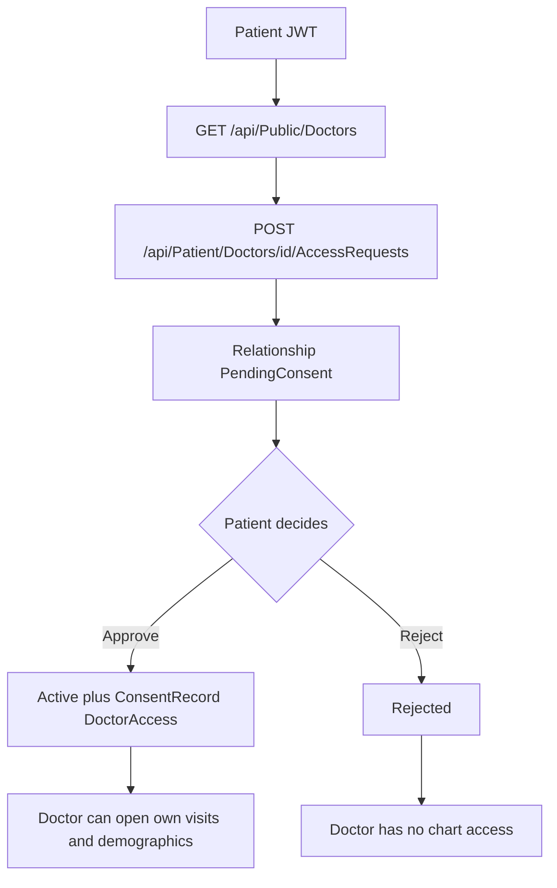
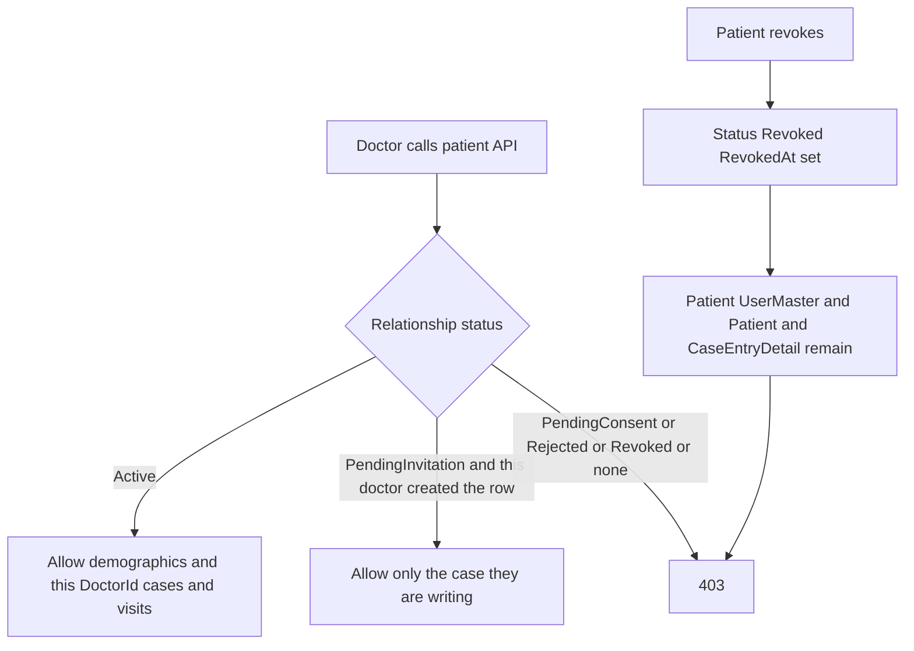
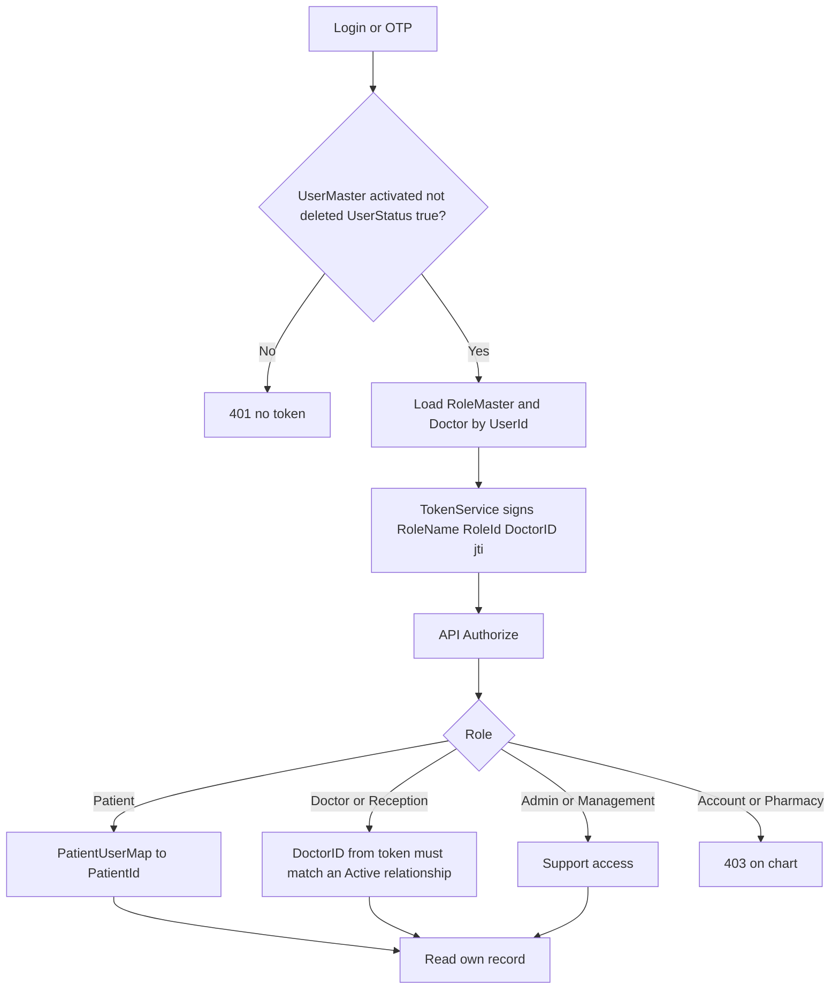

# Patient and Doctor Onboarding, Ownership, and Access — Current System Analysis

**Status:** Analysis only. No source, schema, API, or mobile change was made for this report.
**Scope:** `NIGA_NewAPI` (the API to use going forward), `NIGAHomeopathy_UI`, `NIGA_PatientApp`, `NIGA_DoctorApp`.
**Date:** 16 October 2026.

This report describes what the code does today, where that differs from the required business scenarios, and the smallest design that fits the existing SQL Server, JWT, and React architecture. Proposed states and a doctor–patient relationship table are recommendations. They are not present in the current schema.

---

## 1. Executive summary

A patient and a doctor are already separate ideas in the database: a login row (`UserMaster`), a clinical person (`Patient`), a practitioner profile (`Doctor`), and a link from a patient login to one primary clinical row (`PatientUserMap`). There is **no doctor–patient relationship**. A doctor can see a patient only because a case paper (`CaseEntryDetail`) or an appointment (`PatientAppointment`) exists. Those rows are clinical records. They are not membership, consent, or a switch that can be turned off without touching history.

What works today:

- A patient can sign in on the Patient Mobile App with a mobile OTP (`POST /api/PatientAuth/RequestOtp`, `POST /api/PatientAuth/VerifyOtp`) and, if no login exists, complete a profile that creates a `Patient` plus a Patient-role `UserMaster` (`POST /api/patient` with `entityType: PatientMobile`). That path does not attach a doctor.
- A doctor or reception user on the web, and a signed-in doctor on the Doctor Mobile App, can create a patient. The API then opens a `CaseEntryDetail` for the JWT doctor. That is the only “this patient belongs to this doctor” link.
- A patient can later search verified, directory-visible doctors (`GET /api/Public/Doctors`) and book (`POST /api/Public/Doctors/{id}/Bookings`). The booking creates an appointment. Any non-deleted appointment then grants that doctor broad chart access on several APIs.
- Doctors self-register (`POST /api/users/RegisterDoctor` and `POST /api/users/RegisterDoctorWithDocuments`). Password login stays closed until email activation (`UserMaster.IsUserActivated`). Admins approve credentials on `POST /api/Trust/{doctorId}/Decide`.

What does not work for the required scenarios:

- A doctor-created patient does **not** receive an invitation, OTP, SMS, or WhatsApp message, and the Doctor Mobile App does not ask the API to create a patient login. The patient cannot claim that chart by signing up later with the same mobile. A second `Patient` row is created instead.
- There is no patient approval before a doctor sees the chart, and no way to disconnect a doctor without deleting the case or the appointment.
- Access rules disagree. The patient board uses cases. Timeline and visits require an appointment. `PatientAccessGuard` allows the first case’s doctor **or** any doctor with an appointment, and that access is to the whole patient, not to one visit.
- Account creation for mobile patients does not require a verified OTP on the server. `POST /api/patient` with `EntityType` `PatientMobile` or `DoctorMobile` is anonymous and will create a login.
- Doctor approval does not control login, and it does not publish the doctor. `DirectoryVisible` is set to false at registration and no application code sets it back to true. `PracticeActivated` is never set to true.
- Patient OTP codes are returned in the API body as `devCode`. The PatientAuth path does not send SMS.

Until a real relationship exists, multi-doctor care, consent, revocation, and duplicate prevention cannot be done safely on the current tables.

---

## 2. Current system architecture

| Layer | Location | Onboarding role |
| --- | --- | --- |
| API | `NIGA_NewAPI/Homeocentrum.Niga.API` | Controllers, JWT, authorization |
| Domain | `NIGA_NewAPI/Homeocentrum.Niga.API.Domain` | Entities, `PatientService`, `UserService`, access guards |
| Database | SQL Server, mapped in `NIGACentrumContext` | `UserMaster`, `Patient`, `Doctor`, `PatientUserMap`, `CaseEntryDetail`, `PatientAppointment`, `ConsentRecord` |
| Web | `NIGAHomeopathy_UI` | Doctor registration, doctor/reception patient create, admin trust queue |
| Patient app | `NIGA_PatientApp` | OTP sign-in, profile create, doctor search, booking, privacy consents |
| Doctor app | `NIGA_DoctorApp` | OTP login, registration with documents, patient create |

**API host in source (not a runtime probe):**

- Web `NIGAHomeopathy_UI/src/config.js` uses `https://devapi.homeocentrum.com/api`. `realbackend_helper.js` says every call goes to that host and must not use an old API base URL. `Old_API_Base_URL` is not defined in `config.js`.
- Both mobile apps call `https://devmaigrationapi.homeocentrum.com/` through `newBaseApi`. Each still declares a legacy host `https://devapi1.homeocentrum.com/` on an RTK Query slice with **no endpoints**. Onboarding does not call the old API.

**Identity model already in the database:**

```text
UserMaster (login, role, activation)
    | 1
    | PatientUserMap.IsPrimary (patient logins only)
    v
Patient (clinical person: name, mobile, email, address)
    |
    +-- CaseEntryDetail.DoctorId     clinical case paper, one row per case
    +-- PatientAppointment.DoctorId  one row per visit
    +-- PatientFamilyMember          another Patient row under the same login

Doctor (practitioner profile) -- UserId --> UserMaster
DoctorVerification, DoctorCredentialDocument, DoctorVerificationEvent
```

`Patient` has no `UserId` and no `DoctorId`. Ownership is inferred.

---

## 3. Existing patient onboarding workflow

### 3.1 Patient Mobile App — independent registration

Screens and controllers:

| Step | App file | API |
| --- | --- | --- |
| Language, splash, onboarding slides | `NIGA_PatientApp/src/navigation/AppNavigator.tsx` | none |
| Mobile entry | `src/controllers/useSignInController.ts`, `src/store/api/new/signInApi.ts` | `POST api/PatientAuth/RequestOtp` |
| OTP | `src/controllers/useOtpVerificationController.ts`, `src/store/api/new/otpVerificationApi.ts` | `POST api/PatientAuth/VerifyOtp` |
| Profile | `src/controllers/useCompleteProfileController.ts`, `src/store/api/new/completeProfileApi.ts` | `POST api/patient/` with `entityType: "PatientMobile"` |
| Privacy consents | `src/store/api/new/consentApi.ts` | `GET/POST api/Patient/Consents...` |
| Home, doctor search | `src/store/api/new/doctorsApi.ts` | `GET api/Public/Doctors` |

`AppNavigator.handleOtpVerified` sends a registered user to home and an unregistered user to complete profile.

**Server: `PatientAuthController`** (`NIGA_NewAPI/Homeocentrum.Niga.API/Controllers/PatientAuthController.cs`)

1. `RequestOtp` normalizes the mobile, rate-limits to 3 requests per minute, stores `OtpChallenge` (`Action = PatientAuth`, hash only, 10 minutes, lock after 5 failures).
2. It sets `isUserRegistered` when any non-deleted Patient-role `UserMaster` has that mobile. `IsUserActivated` is ignored for this flag.
3. The plaintext code is always returned as `devCode`. The controller comment states the SMS vendor is not live. This method does not call `ISmsSender`.
4. `VerifyOtp` checks the hash. It returns a JWT only when a `Patient` row matches the mobile **and** an activated `UserMaster` can be resolved through `PatientUserMap` or by mobile. The token is `TokenService.CreateToken` for 7 days, with role name and `DoctorID` if that user also has a `Doctor` row.

**Server: create profile** — `PatientController.Post` then `PatientService.SavePatient`, then `CreatePatientLoginAsync`.

- Anonymous callers may create (`PatientID == 0`) only when `EntityType` is `DoctorMobile` or `PatientMobile` (`PatientEntityTypes` in `Domain/DTOs/PatientModel.cs`). Updates require a token.
- No doctor id is present, so `SavePatient` inserts `Patient` and does **not** insert `CaseEntryDetail`.
- `CreatePatientLoginAsync` inserts `UserMaster` with `RoleId` of the `Patient` role, `UserStatus = true`, `IsUserActivated = true`, username = digits (or `digits_PatientId` if the username exists), and a random password. It inserts `PatientUserMap` (`IsPrimary = true`).
- The create response does not include a token. The app then calls RequestOtp and VerifyOtp itself, using `devCode`, and stores that token (`useCompleteProfileController.ts`).

**Patient with no doctor:** the account is a normal Patient login. Home, profile, family, and consents work. Doctor search is the public directory. Nothing in the patient row says “unassigned”. The patient is simply absent from every doctor’s case list.

**Later connection:** booking is the only implemented connection. `PublicController.CreateBooking` requires a verified PatientAuth OTP session, a directory-visible doctor with `VerificationStatus == "Verified"`, and an open slot. It finds a patient with `MobileNo` **equal to** the digits (not the normalized compare used by PatientAuth). If none matches, it inserts another `Patient` and no login. It inserts `PatientAppointment` with `ConsentPolicyVersion` from the request or the current Terms policy. It does not insert `CaseEntryDetail` and it does not ask the patient to approve chart access.

### 3.2 Web patient portal

The web app has a Patient layout (`usesPatientDashboardLayout` in `NIGAHomeopathy_UI/src/Components/constants/roles.js`). Patient self-registration on the web was not found. Web patient create is the clinic form (`EntityType: "Web"`), which requires a token.

---

## 4. Existing doctor onboarding workflow

### 4.1 Registration

| Channel | File | Endpoint |
| --- | --- | --- |
| Web form | `NIGAHomeopathy_UI/src/pages/Authentication/Register.js` | `POST /users/RegisterDoctorWithDocuments` |
| Status page | `src/pages/Authentication/RegisterStatusPage.js` | `GET /users/RegistrationStatus?emailId=` |
| Pending page | `src/pages/Authentication/RegisterPendingPage.js` | none (copy only) |
| Doctor app | `NIGA_DoctorApp/src/store/api/new/registerCredentialsApi.ts`, `src/controllers/useRegisterCredentialsController.ts` | `POST api/users/RegisterDoctorWithDocuments` |
| Lookups | `RegistrationController.GetQualifications` | `GET /api/registration/qualifications` |
| Lookups | `MobileDoctorController` country/state/district/city | `GET /api/MobileDoctor/Registration/...` (legacy aliases under `/api/registration/...`) |

`UserService.RegisterDoctor` (`Domain/Repositories/UserService.cs`):

1. Rejects a non-deleted `UserMaster` with the same email or username. Mobile is not a uniqueness check. There is no database unique index on `UserMaster.EmailId` or `UserName` in `NIGACentrumContext`.
2. Inserts `UserMaster`: `RoleId = 3` (hard-coded; comments and login treat 3 as Doctor), `UserStatus = true`, `IsUserActivated = false`, PBKDF2 password, 48-hour SHA-256 activation token.
3. Inserts `Doctor`: `VerificationStatus = "Pending"`, `DirectoryVisible = false`, `PracticeActivated = false`, qualification, university, certificate number, clinic name, location.
4. Inserts `DoctorVerification` with `Status = "Pending"`.
5. Sends an activation email. If mail fails, the rows stay and the message says the email was not sent.

`UsersController.RegisterDoctorWithDocuments` then saves optional qualification and registration files to `DoctorCredentialDocument`. Rejected files do not fail registration. **It then issues a 7-day JWT even though `IsUserActivated` is false.**

### 4.2 Activation, login, and approval

| Action | Endpoint | Effect |
| --- | --- | --- |
| Activate by emailed token | `POST /api/users/ActivateByToken` | `IsUserActivated = true`, token cleared |
| Legacy encrypted-id activate | `POST /api/users/ActivateUser` | same flag |
| Resend | `POST /api/users/ResendActivation` | new 48-hour token; does not reveal whether the email exists, except when already activated |
| Password login | `POST /api/Account/Login` | Rejects `IsUserActivated != true` with “Account is deactivated”. Does not read `VerificationStatus`, `DirectoryVisible`, or `PracticeActivated`. Issues JWT with `RoleName`, `RoleId`, and `DoctorID`. |
| Doctor app OTP | `POST /api/Otp/RequestOtp` (`Action=Login`) then `POST /api/MobileDoctor/LoginWithOtp` | Finds the user from `Doctor.MobileNo`. Blocks only when **both** `IsUserActivated != true` and `UserStatus != true`. A new doctor (`UserStatus true`, not activated) can OTP-login before the email link is used. |
| Admin queue | `GET /api/Trust/Queue` | Admin only (`S4Week4Service.VerificationQueueAsync`) |
| Admin decision | `POST /api/Trust/{doctorId}/Decide` | Body decision `Approve`, `Reject`, or `NeedsInfo` → `Doctor.VerificationStatus` `Verified`, `Rejected`, or `NeedsInfo`. Inserts `DoctorVerificationEvent`. Emails the doctor. |
| Web queue | `NIGAHomeopathy_UI/src/pages/Admin/Trust/TrustQueuePage.js` | Route `admin/trust-queue`, roles Admin and Management |

`DecideVerificationAsync` does **not** update the `DoctorVerification` row created at registration, does **not** set `DirectoryVisible`, and does **not** set `PracticeActivated`. Public search (`PublicController`) requires `DirectoryVisible && VerificationStatus == "Verified"`. A verified doctor stays invisible in the patient app until some out-of-band update sets `DirectoryVisible`. No C# assignment sets `DirectoryVisible = true`.

There is no suspend or reactivate doctor endpoint. Admin soft-delete is `POST /api/users/DeleteUser` (`UserMaster.DeleteStatus = true`). It does not set `Doctor.DeleteStatus`, revoke tokens, or close relationships. `UserStatus` can be edited through admin `POST /api/users` (`AddUser` update). Password login does not check `UserStatus` or `DeleteStatus` on the username lookup (it loads any `UserMaster` with that username, including deleted).

---

## 5. Existing doctor-created patient workflow

### 5.1 Web and reception

`NIGAHomeopathy_UI/src/helpers/realbackend_helper.js` `createPatient` posts `{ ...data, EntityType: "Web" }` to `/patient`.

Callers:

- `src/pages/Doctor/Dashboard/Widgets.js`
- `src/pages/Doctor/Dashboard/BestSellingProducts.js`
- `src/pages/Reception/components/ReceptionNewPatientForm.js`

`PatientController.Post` when the caller is authenticated:

- Ignores a client-supplied `DoctorID` and sets it from the JWT `DoctorID` claim, unless the caller is a global admin.
- Reception JWTs carry the clinic `DoctorID` plus `DoctorUserID`. The case is stored under the doctor’s user id, not the staff id.
- `PatientService.SavePatient` inserts `Patient` and, when that doctor exists, one `CaseEntryDetail` (`DoctorId`, `UserId`, first-visit date, referred-by).

`EntityType = Web` is not mobile, so `CreatePatientLoginAsync` does not run. No email, SMS, WhatsApp, or OTP is sent. `IsWhatsAppOptIn` is only a flag on `Patient`.

### 5.2 Doctor Mobile App

`NIGA_DoctorApp/src/controllers/useHomeController.ts` calls `savePatient` (`src/store/api/new/patientsApi.ts` → `POST api/patient`) with patient fields and `loggedInUser` / `userId`. It does **not** send `entityType`.

Because the doctor is authenticated, the API still binds `DoctorID` from the JWT and creates the case. Because `EntityType` is empty, it does **not** create a patient login. If the mobile already belongs to another patient who has an activated login, the response sets `isUserAlreadyRegistered = true` and the app shows `patientsDuplicateMobileWarn`. The new `Patient` row and case are already saved. The existing login is not linked to the new row.

### 5.3 How the patient would open the app later

They cannot claim the doctor-created chart.

1. OTP `isUserRegistered` is false (no Patient-role user).
2. VerifyOtp finds a `Patient` by normalized mobile but no activated user, so it returns success **without** a token (`isUserAlreadyRegistered` false).
3. The app opens complete profile and posts a **new** `Patient` plus a new login.
4. `AttachTokenForExistingMobileAsync` looks for the same mobile on a **different** patient id. It sets `isUserAlreadyRegistered` only when that other row already has an activated user. It does not stop the insert, does not merge, and does not return a token (“knowing a mobile number is not proof”).
5. The patient now has two clinical rows. The doctor’s case points at the first. The app session points at the second.

Public booking has the same split: it matches `MobileNo` with exact equality, so `9876543210` and `919876543210` can become two patients.

---

## 6. Existing independent patient registration workflow

Covered in section 3.1. Summary against Scenario A:

| Requirement | Current behavior |
| --- | --- |
| Patient creates their own account | Yes, after OTP, via `POST /api/patient` |
| No automatic doctor | Yes. No `CaseEntryDetail` when `DoctorID` is 0 and there is no logged-in doctor |
| Search and connect later | Search and book only. Booking is an appointment, not an approved relationship |
| Unassigned patient remains usable | Yes, as a Patient login with no cases |

The OTP step is not bound to profile creation. Anyone who can call `POST /api/patient` with `entityType: "PatientMobile"` and `patientID: 0` creates a patient and an activated login without proving they own the mobile.

---

## 7. Current authentication, authorization, and access control

### 7.1 JWT

`TokenService.CreateToken` (`Domain/Services/TokenService.cs`) signs HMAC-SHA512 with configured issuer and audience. Claims:

- `ClaimTypes.NameIdentifier` and `nameid`: `UserMaster.UserId` (reception tokens use reception staff id instead)
- `unique_name`: username
- `RoleId`, `RoleName`, `ClaimTypes.Role`
- `FirmIds`
- `jti`
- `DoctorID` when a doctor id is passed
- Reception also gets `DoctorUserID` and `FullName`

Role is copied from `RoleMaster` at login. A client cannot change it without the signing key. The server trusts the claims after signature validation; it does not re-read `RoleId` on every request. Logout denylists `jti` in memory (`AccountController.Logout`). A 7-day token from `RegisterDoctorWithDocuments` or `LoginWithOtp` stays valid until expiry or process recycle.

### 7.2 Roles

`RoleMaster` / `RoleDetail` is menu view/add/modify/delete, not a per-patient permission. Names used in code:

| Role | Where it matters |
| --- | --- |
| Admin, Management | `AdminAuthorizationPolicies.AdminPortal`. RoleId 1 is also treated as super user |
| Doctor | RoleId hard-coded to 3 on self-registration. Clinical case-taking, ownership |
| Reception | Staff token for one clinic. Can create patients. Cannot run case-taking (`DoctorOwnership.ForbidIfNotTreatingDoctor`) |
| Patient | Portal owner via `PatientUserMap` |
| Account | Money APIs. Blocked from patient PII by `IsMoneyOnlyRole` where that helper is used |
| PharmacyPartner / Pharmacy | Orders |
| Supervisor, Inspector | Named in the web role list. Not used by the onboarding paths reviewed here |

Dev-only: user id 10032 (`Tufan_Doctor`) receives admin-portal rights when `Security:DevPrivilegedDoctor` is enabled and the host is Development. `DoctorOwnership.IsGlobalAdminPortalUser` still refuses that user when the check is clinic ownership.

### 7.3 Who may read a patient

Three different rules exist.

**A. Clinic list** — `PatientService.GetCases` and `getAllCases`. Rows where `CaseEntryDetail.DoctorId` is the caller’s doctor and `DeleteStatus == false`. A patient with only an appointment does not appear. `GET /api/patient/{UserId}` and `GET /api/patient/getAllCases` check `DoctorOwnership.EnsureCallerIsUserOrAdmin` on the user id.

**B. Case detail** — `PatientController.CanAccessPatientAsync`. Global admin, or JWT doctor equals the case’s doctor, or the JWT doctor has any non-deleted appointment with that patient, or `PatientUserMap` / `PatientFamilyMember` matches. `PatientAccessGuard` is the same idea, but if the caller does not pass a doctor id it uses the **first** case’s doctor only.

**C. Timeline, visits, documents, follow-ups** — `S4Week4Service.ResolvePatientAsync`. Patients may read only `S4Caller.PatientId` (primary `PatientUserMap`, no auto-create). Doctors may read only when a non-deleted `PatientAppointment` exists for that doctor, and doctor writes are rejected. A doctor-created patient with a case and no appointment gets **403** “This patient is not on your list” from `GET /api/Patient/Timeline` and `GET /api/Patient/Visits`.

So a doctor who registered the patient can see them on the board and not on the mobile timeline. A doctor who only has an appointment can see the timeline and, through `PatientAccessGuard`, the whole case if some other endpoint uses that guard. Cancelling an appointment does not remove it from the access query; the filter is `DeleteStatus != true`, not status.

`ConsentRecord` is not consulted by these checks.

### 7.4 Consent that exists today

`ConsentType` codes seeded in `ScriptsAndFiles/S1_Week1/Database scripts/01_SEC_M01_Foundation_Security_Server.sql`:

`Privacy`, `Booking`, `TeleRecording`, `PharmacyShare`, `Marketing`, `Caregiver`.

`ConsentController` (`/api/Consent/Grant`, `/Withdraw`, `/ListMine`, `/Patient/{patientId}`) stores notice version, hash, IP, user agent, and guardian evidence for minors. `PatientConsentsController` exposes `/api/Patient/Consents` for the patient app. None of these rows has a `DoctorId`. Withdrawing privacy consent does not remove a doctor’s case or appointment access.

`CaregiverAuthorization` lets another user act for a patient (`PatientPortalOwnerResolver`). That is caregiver access, not doctor access.

---

## 8. Current database entities and relationships

| Table | Entity | Relevant columns | What it is |
| --- | --- | --- | --- |
| `UserMaster` | `UserMaster` | `UserId`, `UserName`, `UserPassword`, `UserStatus`, `DeleteStatus`, `MobileNo`, `EmailId`, `RoleId`, `IsUserActivated`, `ActivationTokenHash`, `ActivationExpiresAt` | Login |
| `RoleMaster`, `RoleDetail` | same | `RoleName`; menu flags | Menu RBAC |
| `Patient` | `Patient` | `PatientID`, name, mobile (15), email (100), address, `DeleteStatus`, `IsWhatsAppOptIn` | Clinical person. No user id, no doctor id, no registration source |
| `PatientUserMap` | `PatientUserMap` | `UserId`, `PatientId`, `IsPrimary`, `DeleteStatus` | Login ↔ clinical row. Filtered unique index `UX_PatientUserMap_User_Primary` in `Database/Scripts/M16_Family_Caregiver.sql` (one primary map per user). Not a unique patient-wide mobile |
| `PatientFamilyMember` | `PatientFamilyMember` | owner user, owner patient, member patient | Family members are real `Patient` rows |
| `Doctor` | `Doctor` | `DoctorId`, `UserId`, qualification, `VerificationStatus` (30), `DirectoryVisible`, `PracticeActivated` | Practitioner profile |
| `DoctorVerification` | `DoctorVerification` | `DoctorId`, `Status`, reviewer | Written at registration; decision path does not update it |
| `DoctorVerificationEvent` | SQL only (read by raw SQL) | `DoctorId`, `Status`, `Note`, `ByUserId`, `At` | Decision history |
| `DoctorCredentialDocument` | `DoctorCredentialDocument` | file metadata | Uploaded certificates |
| `CaseEntryDetail` | `CaseEntryDetail` | `CaseId`, `PatientId`, `DoctorId`, `UserId`, `DeleteStatus` | Case paper. Closest current “link”, and the wrong place to store consent |
| `PatientAppointment` | `PatientAppointment` | `PatientAppId`, `PatientId`, `DoctorId`, `Status`, `DeleteStatus`, `ConsentPolicyVersion`, `BookingChannel` | A visit. Also used as an access grant |
| `ConsentType`, `ConsentRecord`, `ConsentNotice` | same | subject type/id, grant/withdraw, notice hash | Policy consent, not per-doctor access |
| `OtpChallenge` | `OtpChallenge` | action, entity, hash, expiry, attempts | OTP |
| `CaregiverAuthorization` | `CaregiverAuthorization` | patient, caregiver user, `RevokedAt`, `Scope` | Caregiver grant |

`DoctorPatientBoardBackup` is a JSON backup of a doctor’s board. It is not a relationship table.

No unique constraint on `Patient.MobileNo`, `Patient.Email`, `UserMaster.MobileNo`, or `UserMaster.EmailId` is mapped in `NIGACentrumContext`. Duplicate prevention is a read-then-insert in application code.

---

## 9. Gaps between the current implementation and the business requirements

| Scenario | Gap |
| --- | --- |
| A. Independent patient | Account can be created without a verified OTP on the server. “Connect with a doctor” is only booking. No pending/active relationship. Unassigned state is implicit. |
| B. Doctor registers a patient | Case is created. No invitation, no OTP claim, no patient login on the doctor app or web. Same mobile later creates a second patient. Exact vs normalized mobile match makes this worse. |
| C. One patient, many doctors | Multiple cases and appointments can point at one `Patient`, so the schema can already avoid a second patient **if** the code reuses the row. It does not. Access is all-or-nothing per patient and inconsistent between board and timeline. No patient approval. No disconnect that keeps history. |
| D. Doctor onboarding | Email activation exists, but document registration returns a JWT immediately and OTP login ignores “not activated” when `UserStatus` is true. Approval does not gate login or the directory. `PracticeActivated` is unused. No suspend/reactivate. `DoctorVerification` and `Doctor.VerificationStatus` diverge after a decision. |

Security gaps that follow from the same code:

- Anonymous `POST /api/patient` creates an activated Patient login.
- `devCode` is returned for PatientAuth and for generic OTP.
- Knowing a mobile warns about a duplicate and still inserts a new chart.
- Two concurrent creates of the same mobile both succeed.
- Appointment `DeleteStatus` is the access switch for timeline; clinical delete is the switch for the board. Neither is a consent revocation, and deleting them to “disconnect” destroys or hides history.
- Password login does not exclude `DeleteStatus = true`.
- Issued JWTs are not tied to `IsUserActivated` or verification, so a token minted at registration keeps working.

---

## 10. Recommended patient and doctor onboarding workflows

Keep the four existing objects. Do not merge login and clinical profile.

| Concept | Store it in | Meaning |
| --- | --- | --- |
| Login | `UserMaster` | Username, password or OTP, role, account status |
| Patient profile | `Patient` | The clinical person. One row per real person |
| Doctor profile | `Doctor` | The practitioner. One row per practitioner |
| How the patient row was born | New column `Patient.RegistrationSource` | `Self`, `Doctor`, `Reception`, `PublicBooking` |
| Patient login claim | `UserMaster.IsUserActivated` plus OTP | Doctor-created charts start without a login, or with a login that cannot be used until the mobile is proved |
| Doctor credential review | `Doctor.VerificationStatus` (single source) | Pending, NeedsInfo, Verified, Rejected |
| Doctor may sign in | `UserMaster.IsUserActivated` and not deleted/suspended | Separate from being listed or allowed to treat |
| Doctor listed to patients | `Doctor.DirectoryVisible` | Set true only after Verified, by the same admin decision or an explicit publish action |
| Doctor–patient link | **New** relationship table (section 11) | Not a case and not an appointment |
| Consent | Relationship row plus a `ConsentRecord` | The relationship is the authorization; the consent row is the audit |
| Account vs relationship | Different columns | Suspending a user does not delete `Patient`. Revoking a relationship does not delete cases |

### Scenario A — patient registers alone

1. Request OTP. Do not return `devCode` outside Development.
2. Verify OTP. If a Patient-role user exists, issue JWT. If a `Patient` exists with no login (doctor-created), go to claim (section 10, scenario B step 4), not to a second create.
3. If nothing exists, create `UserMaster` (Patient, activated) and `Patient` in one transaction, `RegistrationSource = Self`, `PatientUserMap` primary. No relationship row.
4. The patient uses the app with an empty doctor list. Search shows doctors who are Verified and `DirectoryVisible`. Connecting creates a relationship in `PendingConsent` or `Active` according to the business decision in section 24. Booking a slot remains a visit; it should not by itself open the full historical chart.

### Scenario B — doctor registers a patient

1. Doctor or reception must be authenticated, activated, and (for doctors) not Rejected. Bind doctor id from the JWT only.
2. Normalize mobile and email. If a `Patient` already exists, do not insert another. Attach a relationship for this doctor (pending consent if the patient already has a login; active in-clinic relationship only if the business confirms implied consent).
3. If no patient exists, insert `Patient` with `RegistrationSource = Doctor` or `Reception`, and the relationship. Do not invent a password the patient never sees.
4. Send one claim message: SMS if the provider is live, otherwise WhatsApp only when `IsWhatsAppOptIn` is true, otherwise email if an address exists. The message carries a one-time claim token or asks the patient to open the app and enter OTP on that mobile. Store only a hash, with expiry (the activation-token pattern on `UserMaster` is the right shape).
5. Patient installs the app, OTP-proves the mobile, and the server links `PatientUserMap` to the **existing** `PatientId`. Profile fields the doctor entered stay; the patient may correct them.
6. Until claim, the clinic can still chart the in-clinic case they created. The patient cannot sign in.

### Scenario C — additional doctors

1. Patient searches and requests a doctor, or a doctor requests a known patient (matched by claimed mobile, never by creating a row).
2. The other party’s approval is stored on the relationship (section 12).
3. Each doctor’s cases, prescriptions, and appointments stay under that `DoctorId`, as they do now.
4. Disconnect sets the relationship to `Revoked`, stamps who did it and when, and leaves `Patient`, cases, and appointments in place. Later reads check the relationship, not “any appointment row exists”.

### Scenario D — doctor access

1. Registration creates login (not activated), doctor profile (Pending), verification row, and optional documents. Do not return a JWT.
2. Email activation sets `IsUserActivated`. Password and OTP login both require it, and both reject `DeleteStatus` and a suspended `UserStatus`.
3. Login is allowed while verification is Pending, so the doctor can see “awaiting review” and upload documents. Clinical write and public listing stay closed until `Verified`.
4. Admin Approve sets `VerificationStatus = Verified`, updates `DoctorVerification` and `DoctorVerificationEvent` together, and sets `DirectoryVisible` according to the decision in section 24. Reject and NeedsInfo keep the directory off and email the note (already implemented).
5. Suspend sets `UserStatus = false`, denies new logins, and denylists current tokens (today the denylist is in-memory only; a durable denylist is required if suspend must bite immediately). Reactivate sets `UserStatus = true` without deleting the doctor or patients.

---

## 11. Recommended doctor–patient relationship and consent model

### Why a new table is required

`CaseEntryDetail` is the case paper. Using it as membership means “disconnect” deletes or hides the case. A second case with the same doctor is normal clinically and would look like a second relationship.

`PatientAppointment` is a visit. Using “any non-deleted appointment” as access is already how timeline works, and it cannot express pending, rejected, or revoked. A cancelled visit would still grant access unless `DeleteStatus` is set.

`ConsentRecord` has no doctor id. It is the right audit of “the patient agreed to notice version X”. It cannot answer “may doctor 42 read this chart?”.

`PatientUserMap` links a login to a patient. It must stay that, including family members.

Add one table, name it `DoctorPatientRelationship`:

| Column | Purpose |
| --- | --- |
| `DoctorPatientRelationshipId` | Identity |
| `DoctorId`, `PatientId` | The pair. Unique filtered index where status is not Rejected/Revoked, or a unique index on the pair plus “one open row” |
| `Status` | Section 12 |
| `Source` | `DoctorCreated`, `PatientRequested`, `Booking`, `Reception` |
| `InitiatedByUserId` | Who asked |
| `ConsentRecordId` nullable | Points at the notice the patient accepted |
| `RequestedAt`, `RespondedAt`, `RevokedAt` | Times |
| `RevokedByUserId`, `RevokeReason` | Disconnect |
| `EnteredBy`, `EnteredDate`, `ChangedBy`, `ChangedDate`, `DeleteStatus` | Same audit style as the rest of the schema |

Do not backfill history by inventing Active rows for every old case. A one-time migration can insert `Active` for each distinct `(DoctorId, PatientId)` that already has a non-deleted case or appointment, with `Source = Migrated` and a note that consent was not collected. New access checks use the table after migration. Old rows stay.

What each doctor may see once status is `Active`:

- Their own `CaseEntryDetail`, remedies, and diagnoses.
- Their own `PatientAppointment` and prescriptions tied to those visits.
- Demographics on `Patient` (name, age, contact) because they cannot treat without them.
- Other doctors’ case text and prescriptions: **not by default**. The current APIs often return the whole patient. That should narrow to the caller’s `DoctorId` plus demographics. A later “share history” flag can be a column on the relationship if the business wants it. It should default off.

Patient approval: record it as a status change to `Active` plus a `ConsentRecord` of a new consent type `DoctorAccess`, with `Notes` or a new nullable `RelatedDoctorId` on `ConsentRecord` only if you do not want the relationship id lost. Prefer `ConsentRecordId` on the relationship so `ConsentRecord` stays unchanged.

---

## 12. Recommended account, verification, and relationship states

These states are a target. Only the ones marked “exists” are in the code.

### Patient login (`UserMaster` for role Patient)

| State | Exists today | Allowed |
| --- | --- | --- |
| No login, clinical row only | Yes, after doctor create or public booking | Clinic can chart if a relationship or legacy case exists. Patient cannot sign in |
| OTP pending | `OtpChallenge` only | Request and verify. No chart |
| Active (`IsUserActivated` and `UserStatus`, not deleted) | Yes | App access to own patient id |
| Suspended (`UserStatus = false`) | Column exists; login does not enforce it for password | No sign-in. Data kept |
| Closed (`DeleteStatus`) | Soft delete exists | No sign-in. Data kept |

### Doctor account and verification (keep them separate)

| Layer | Values | Exists | Who changes it | Effect to enforce |
| --- | --- | --- | --- | --- |
| Login activation | Not activated / Activated | `IsUserActivated` | Email token; admin create already forces true | Both login methods require true. No JWT before that |
| Login standing | Active / Suspended / Closed | `UserStatus`, `DeleteStatus` | Admin, Management | Suspended and closed cannot log in; tokens invalidated |
| Credential review | `Pending`, `NeedsInfo`, `Verified`, `Rejected` | On `Doctor.VerificationStatus`. Queue also treats null, empty, and `Unverified` as open | Admin decision endpoint | Pending: login and document upload only. Verified: may practise. Rejected: no new patients, no directory. NeedsInfo: login and re-upload |
| Directory | Hidden / Visible | `DirectoryVisible`, only ever set false in code | Admin, and only if status is Verified | Patient search and public booking |
| Practice flag | `PracticeActivated` | Always false after register; never read as a gate | Leave unused until the business defines it against subscription (`IsPlanActive` already exists on login) | Do not add a third “active” meaning without that decision |

### Relationship

| Status | Who sets it | Patient | Doctor |
| --- | --- | --- | --- |
| `PendingInvitation` | Doctor/reception creates a chart the patient has not claimed | May claim with OTP | May use the in-clinic case they created. Must not see a different doctor’s history |
| `PendingConsent` | Patient requests a doctor, or doctor requests an existing claimed patient | Approve or reject | No new chart access |
| `Active` | Patient approves, or in-clinic rule if the business confirms implied consent | Full own record. Can revoke | Own cases, own visits, demographics |
| `Rejected` | Patient declines | Can request again later (new row or reopen) | No access from this request |
| `Revoked` | Patient or admin. Doctor may request disconnect; patient or admin confirms unless the business allows the doctor to revoke their own link | Keeps account and history | Loses access immediately. Rows remain |

---

## 13. Required database changes

### 13.1 New table `DoctorPatientRelationship`

**Problem.** Cases and appointments cannot represent invitation, consent, or revocation.
**Current evidence.** Sections 8 and 11. No equivalent table exists.
**Change.** Create the table in section 11 under `NIGA_NewAPI/Database/Scripts/`, map it in `NIGACentrumContext`, add an entity beside `PatientUserMap`.
**Depends on.** Business answers in section 24 for implied in-clinic consent and history sharing.
**Priority.** Critical.
**Test.** Unique open pair. Status check constraint. Revoke does not delete `Patient` or `CaseEntryDetail`.

### 13.2 Uniqueness for a real person

**Problem.** Duplicate charts.
**Current evidence.** `PatientService.SavePatient` always inserts when `PatientID == 0`. No unique index in the EF model. Matching is sometimes normalized (`PhoneNormalizer`) and sometimes `==`.
**Change.** Persist a canonical mobile (digits, consistent country rule) and add a filtered unique index on `Patient.MobileNo` where `DeleteStatus = 0` and mobile is not null. Do the same for Patient-role `UserMaster.MobileNo`. Email unique for `UserMaster` where email is not null and `DeleteStatus = 0`, matching the application check in `RegisterDoctor`.
**Depends on.** A data cleanup of existing duplicates before the index is created. That cleanup is a migration task, not an automatic merge.
**Priority.** Critical.
**Test.** Second insert with the same mobile fails with a constraint error and the API returns the existing patient id to an authorized caller only.

### 13.3 `Patient.RegistrationSource`

**Problem.** EntityType is not stored (`PatientModel` comment: “Not stored”).
**Change.** `nvarchar(20)` null on old rows, set by the API on new rows.
**Priority.** High.
**Test.** Self, doctor, reception, and public booking each persist the right value.

### 13.4 One verification status

**Problem.** `DecideVerificationAsync` updates `Doctor.VerificationStatus` and `DoctorVerificationEvent` only.
**Change.** Update `DoctorVerification` in the same transaction. Stop treating the two as independent.
**Priority.** High.
**Test.** After Approve, both the profile and `DoctorVerification` read `Verified`.

### 13.5 Claim token

**Problem.** No claim path.
**Change.** Reuse `UserMaster.ActivationTokenHash` / `ActivationExpiresAt` only if a patient user row exists. For a chart with no login yet, store the hash on a small `PatientClaim` row (`PatientId`, hash, expiry, consumed at) so a token cannot be reused and is not a password.
**Priority.** High.
**Depends on.** SMS or WhatsApp actually sending (section 19).

### 13.6 Do not add

Another user table, a second patient table, or a general permission framework. `RoleDetail` stays menu security.

---

## 14. Required .NET API changes in `NIGA_NewAPI`

All paths below are under `Homeocentrum.Niga.API` or `Homeocentrum.Niga.API.Domain`.

### 14.1 Stop anonymous patient-login creation

**Problem.** `PatientController.Post` allows anonymous create for mobile entity types and `CreatePatientLoginAsync` activates the user.
**Evidence.** `PatientController` lines 71–93 and 742–800.
**Change.** Require a verified `OtpChallenge` (`Action = PatientAuth`, same mobile, `VerifiedAt` set, not already consumed for create) before creating a patient login. Doctor and web creates remain authenticated and must not call `CreatePatientLoginAsync`.
**Priority.** Critical.
**Test.** Anonymous post without OTP returns 401. With a consumed OTP, returns 400. Doctor JWT create still creates a case and no second login.

### 14.2 Merge on mobile instead of inserting

**Problem.** `SavePatient` does not look for an existing mobile. `AttachTokenForExistingMobileAsync` only sets a flag after insert.
**Change.** In one transaction: normalize mobile; if a patient exists, return it to the doctor only when they are allowed to know (they submitted the mobile they claim to own, and the response is “already registered, invitation sent” without extra clinical data). Link the relationship. If the caller is the patient with a fresh OTP, attach `PatientUserMap` to that row.
**Priority.** Critical.
**Depends on.** 13.2 and 13.1.
**Test.** Doctor create then patient OTP yields one `Patient` and one map. Two parallel posts yield one row.

### 14.3 Relationship authorization

**Problem.** `PatientAccessGuard.CanAccessPatientAsync`, `PatientController.CanAccessPatientAsync`, and `S4Week4Service.ResolvePatientAsync` disagree, and none understand revocation.
**Change.** One method, used by all three: global admin; or the patient’s own map/family; or an `Active` relationship for the JWT doctor. Pending and revoked return 403. Filter cases, notes, and prescriptions by that `DoctorId`. Demographics allowed when the relationship is `Active` or `PendingInvitation` for the creating doctor.
**Priority.** Critical.
**Depends on.** 13.1 and migration.
**Test.** Doctor B cannot read doctor A’s case. After revoke, doctor A’s next call is 403 and the case row still exists.

### 14.4 Doctor login and token gates

**Problem.** `RegisterDoctorWithDocuments` returns a token. `LoginWithOtp` allows non-activated users when `UserStatus` is true. `AccountController.Login` ignores `DeleteStatus` and `UserStatus`. Clinical APIs do not read `VerificationStatus`.
**Evidence.** `UsersController` around the token assignment after document save; `MobileDoctorController.LoginWithOtp`; `AccountController.Login`.
**Change.** Remove the token from registration responses. Both logins require activated, not deleted, `UserStatus` true. Clinical writes and public booking require `Verified`. Pending doctors can call profile and document upload only.
**Priority.** Critical.
**Test.** Register response has no token. OTP before activation returns 401. Rejected doctor cannot `POST /api/patient`.

### 14.5 Directory publish

**Problem.** `DirectoryVisible` is never set true. Approve does not make the doctor searchable.
**Evidence.** Only assignment is `false` in `UserService.RegisterDoctor`. `PublicController` requires the flag.
**Change.** On Approve, set `DirectoryVisible` if the business wants listing to follow verification. Otherwise add an explicit admin publish field to the decide request. Do not let the doctor set the flag on their own profile update (they cannot today; keep it that way).
**Priority.** High.
**Test.** After the chosen publish action, `GET /api/Public/Doctors` includes the doctor. Before it, it does not.

### 14.6 Invitation send

**Problem.** No send exists.
**Change.** After doctor create, enqueue SMS through `ISmsSender` / `SmsOutboxWorker`, or WhatsApp through the existing WhatsApp services when opted in. Email when an address exists. Failure leaves the patient and relationship saved and returns `invitationSent: false` so the clinic can resend.
**Priority.** High.
**Depends on.** A live SMS or WhatsApp provider. Until then, the API must not pretend the message was delivered, and must not put the OTP in the JSON body in non-Development environments.

### 14.7 Suspend and reactivate

**Problem.** `DeleteUser` only flips `DeleteStatus` and does not suspend cleanly.
**Change.** Admin endpoints on `UsersController`: suspend and reactivate. Suspend sets `UserStatus = false` and writes the audit event already used by `SecurityAudit`. Apply the same login checks as 14.4.
**Priority.** High.
**Test.** Suspended doctor and patient receive 401. Their `Patient` and `Doctor` rows remain.

---

## 15. Required React.js web frontend changes

Repository: `NIGAHomeopathy_UI`.

| Change | Why | Files | Priority |
| --- | --- | --- | --- |
| After doctor registration, do not store a token from `RegisterDoctorWithDocuments` | API will stop sending one; pending page already tells the user to check email | `src/pages/Authentication/Register.js`, `src/slices/auth/register/` | Critical, after API 14.4 |
| Patient create shows “invitation sent / not sent” and a resend action | Web create is `EntityType: Web` and currently silent | `src/pages/Reception/components/ReceptionNewPatientForm.js`, `src/pages/Doctor/Dashboard/Widgets.js`, `BestSellingProducts.js` | High |
| If the API returns “existing patient, request sent”, do not show a new empty chart | Duplicate warning must not look like success-with-a-new-id | same patient forms | Critical |
| Trust queue: show directory and login standing, and call publish/suspend when those endpoints exist | Queue already calls `GET /Trust/Queue` and `POST /Trust/{id}/Decide` via `src/helpers/s4Week4Api.js` | `src/pages/Admin/Trust/TrustQueuePage.js` | High |
| No new patient self-registration page | The patient app is the self-serve channel. Adding a second web registration flow is extra surface | — | — |

Web role gates in `src/Components/constants/roles.js` and `src/Routes/allRoutes.js` can stay. Admin and Management keep the trust queue.

---

## 16. Required React Native Patient Mobile App changes

Repository: `NIGA_PatientApp`.

| Change | Why | Files | Priority |
| --- | --- | --- | --- |
| Treat “patient row exists, no token” as claim, not as a new profile | `handleOtpVerified` only branches on registered vs complete profile | `src/navigation/AppNavigator.tsx`, `useOtpVerificationController.ts` | Critical |
| Stop using `devCode` to mint a session after profile create | `useCompleteProfileController.ts` calls RequestOtp and VerifyOtp with `devCode` because create returns no token | `useCompleteProfileController.ts` | Critical |
| Send the verified challenge id to create/claim | Server must bind OTP to create | `completeProfileApi.ts` | Critical, with API 14.1 |
| Doctor connection screen: request, pending, active, disconnect | Search and book exist; relationship does not | `doctorsApi.ts`, a new screen beside `DoctorProfileView` | High |
| Consent centre stays for Privacy/Booking/etc. | Do not overload it as the doctor-access list | `consentApi.ts`, `ConsentCentreView.tsx` | Medium |
| Remove or keep unused `legacyBaseApi` | It has no endpoints. It is not an onboarding dependency. Removing it is cleanup, not part of this feature | `src/store/api/legacy/legacyBaseApi.ts`, `src/config/apiConfig.ts` | Low |

---

## 17. Required React Native Doctor Mobile App changes

Repository: `NIGA_DoctorApp`.

| Change | Why | Files | Priority |
| --- | --- | --- | --- |
| Do not expect a JWT from registration before activation | `registerCredentialsApi.ts` posts to `RegisterDoctorWithDocuments` | `src/controllers/useRegisterCredentialsController.ts` | Critical, with API 14.4 |
| Show verification status from `GET /api/Trust/MyStatus` and block patient create while not verified | Login currently ignores verification | doctor home / registration status | High |
| Handle “existing patient” without adding a second directory row | `useHomeController.ts` still inserts an optimistic row when `isUserAlreadyRegistered` is true | `useHomeController.ts` around the `savePatientApi` call | Critical |
| Pass an explicit channel only if the API still needs it | The app omits `entityType`, which is why no login is created. After the API creates a claim server-side, the app should show invitation status from the response | `patientsApi.ts`, `useHomeController.ts` | High |
| Patient profile: relationship status and “remove access” that calls revoke, not delete patient | No such control exists | patient profile stack in `useHomeController.ts` | High |
| `legacyBaseApi` is empty | Same as the patient app. Not used for registration | `src/store/api/legacy/legacyBaseApi.ts` | Low |

---

## 18. Required administrator functionality

Already present:

- Trust queue and Approve / Reject / NeedsInfo (`TrustController`, `TrustQueuePage`).
- User list and soft delete for Admin portal (`GET /api/users`, `POST /api/users/DeleteUser`).
- Menu rights through `RoleMaster`.

Still required:

| Function | Who | Priority |
| --- | --- | --- |
| Publish or hide directory (`DirectoryVisible`) as part of approval or as a separate button | Admin, Management | High |
| Suspend and reactivate a doctor or patient login without deleting clinical rows | Admin, Management | High |
| See relationship status for support, without browsing full case text unless already allowed | Admin | Medium |
| Revoke a relationship in a dispute | Admin | Medium |
| Resend doctor activation and resend patient claim | Admin, and the doctor for their own patient claim | High |
| Do not add a new admin role | Existing Admin and Management policies | — |

`PracticeActivated` should stay unused until it is defined against the existing subscription flags (`IsPlanActive` on `AccountController.Login`).

---

## 19. Security, privacy, and audit requirements

| Risk | Control |
| --- | --- |
| Duplicate registration | Canonical mobile, unique filtered indexes, serializable transaction or unique-constraint catch (`PatientPortalOwnerResolver` already catches SQL 2601/2627 for the map) |
| Doctor opens an unrelated chart | Server-side `Active` relationship. Never trust a patient id from the query string alone (`ResolvePatientAsync` already rejects a mismatched patient id for patient callers; doctors must get the same treatment) |
| Independent signup attaches to the wrong chart | OTP must match the stored mobile before `PatientUserMap` is written. Do not match on name |
| Account activation by someone who intercepted nothing | Claim token hashed, single use, short expiry, bound to `PatientId` and mobile. Same pattern as `ActivateByToken` |
| OTP in the response | `devCode` only when the host environment is Development. PatientAuth must use `ISmsSender` the way `OtpController` does |
| JWT role edits | Keep server-signed claims. Re-read `IsUserActivated`, `UserStatus`, and `DeleteStatus` on sensitive writes, or keep token lifetime short for new registrations. Durable denylist on suspend |
| Access after revoke | Every patient read checks relationship status at request time, not a permission cached in the JWT. Do not put the patient list in the token |
| API disclosure | Existing-patient responses to doctors return “invitation sent”, not other doctors’ notes. Public doctor search stays limited to directory fields |
| Deleting history on disconnect | Revoke updates the relationship only. `PatientService` delete of a patient stays a separate admin/clinic action and must not be the disconnect button |
| Race | Unique indexes plus one transaction for patient + map + relationship |
| Audit | Extend the existing `SecurityAudit` events for claim, relationship approve/reject/revoke, doctor suspend, and verification decide. Store actor, role, patient id, doctor id. `ConsentRecord` stores notice version and hash |
| Minors | `ConsentController` already requires guardian evidence when the patient is under 18. Doctor-access consent must use that path, not a new one |

Frontend hiding of buttons is not a control. The checks above belong in `PatientAccessGuard` and `ResolvePatientAsync`.

---

## 20. API request and response changes and endpoint requirements

Existing routes stay. Behavior changes are called out. New routes are only those the current API cannot express.

| Method and route | Change |
| --- | --- |
| `POST /api/PatientAuth/RequestOtp` | Keep. Stop returning `devCode` outside Development. Send SMS. |
| `POST /api/PatientAuth/VerifyOtp` | Keep. If a patient row exists without a login, return `claimRequired: true` and no second-create hint that includes clinical data. If a login exists, return the token as today. |
| `POST /api/patient` | Authenticated doctor/reception: upsert by mobile, create relationship, return `invitationSent`. Anonymous patient create: require claim/OTP reference; do not accept a raw `DoctorID`. |
| `POST /api/Public/Doctors/{id}/Bookings` | Keep slot booking. Resolve patient by normalized mobile. Do not create a duplicate. Creating an `Active` full-chart relationship from a booking waits on section 24. |
| `POST /api/users/RegisterDoctor` and `RegisterDoctorWithDocuments` | Keep. Response must not include `token`. |
| `POST /api/Account/Login` and `POST /api/MobileDoctor/LoginWithOtp` | Same activation and suspension rules. |
| `POST /api/Trust/{doctorId}/Decide` | Also update `DoctorVerification` and directory visibility. |
| `GET /api/patient/getAllCases` and `GET /api/patient/{UserId}` | Keep, filtered by `Active` or `PendingInvitation` relationship after migration, not by “any case”. |
| `GET /api/Patient/Timeline` and `GET /api/Patient/Visits` | Use the same relationship rule so a doctor-created patient is visible before the first appointment. |

New routes, all on `NIGA_NewAPI`:

| Route | Who | Purpose |
| --- | --- | --- |
| `POST /api/Patient/Claims/Consume` | Patient after OTP | Bind login to existing `PatientId` |
| `POST /api/Patient/Doctors/{doctorId}/AccessRequests` | Patient | Create `PendingConsent` |
| `POST /api/Doctor/Patients/{patientId}/AccessRequests` | Doctor | Create `PendingConsent` for an existing claimed patient |
| `POST /api/Patient/Relationships/{id}/Decide` | Patient | Active or Rejected |
| `POST /api/Patient/Relationships/{id}/Revoke` | Patient | Revoked |
| `POST /api/Doctor/Relationships/{id}/Revoke` | Doctor | Revoked only for their row, if the business allows doctor-initiated disconnect |
| `GET /api/Patient/Relationships` | Patient | List status, doctor display name, no other patients |
| `POST /api/users/{userId}/Suspend` and `/Reactivate` | Admin portal | Section 14.7 |
| `POST /api/patient/{patientId}/ResendClaim` | Owning doctor, reception, or admin | New claim token |

Response shape for create should add, without removing current fields the apps already read (`patientID`, `message`, `isUserAlreadyRegistered`):

```json
{
  "patientID": 1200,
  "isUserAlreadyRegistered": true,
  "relationshipStatus": "PendingConsent",
  "invitationSent": true
}
```

`isUserAlreadyRegistered: true` must mean “we reused the person”, not “we inserted another row”.

---

## 21. Migration and backward-compatibility considerations

- Do not drop `CaseEntryDetail` or `PatientAppointment`. They remain the clinical record.
- One-time script: for each distinct pair with a non-deleted case or appointment, insert `DoctorPatientRelationship` status `Active`, source `Migrated`, no `ConsentRecordId`. Pairs that appear only on deleted rows are not migrated.
- Until the script runs in an environment, new authorization must treat “no relationship table yet” as today’s rules so a partial deploy does not lock every doctor out. After the script, the relationship is mandatory for new access.
- Existing Patient logins and `PatientUserMap` rows stay.
- Existing doctors with `IsUserActivated = true` stay able to log in. Doctors stuck with `DirectoryVisible = 0` stay hidden until an admin publishes them; do not flip every historical doctor to visible in the same script.
- `RoleId = 3` remains Doctor. Do not renumber roles.
- Web `EntityType: "Web"` and the doctor app’s omitted entity type both mean “clinic create”. Accept both during the change.
- Patient app clients that still auto-verify `devCode` will fail closed once `devCode` is removed. Ship the app change with that API change.
- Tokens already issued at registration remain valid until they expire or the server restarts the in-memory denylist. Suspend work needs a store that survives restart before it is relied on.
- Duplicate mobiles that already exist cannot be unique-indexed until a person merges them. Report them; do not auto-merge charts that may be different people who share a number.

---

## 22. Testing scenarios and acceptance criteria

| # | Scenario | Expected |
| --- | --- | --- |
| 1 | New patient OTP, then profile | One `UserMaster`, one `Patient`, one primary map, zero relationships, JWT role Patient |
| 2 | Same patient searches and requests a verified visible doctor, then approves | One relationship `Active`. Doctor sees demographics and later their own visit. Doctor does not see another doctor’s case text |
| 3 | Patient with zero doctors opens home | App loads. Doctor list empty. No error and no implicit doctor |
| 4 | Doctor creates a patient with a new mobile | One patient, `RegistrationSource` Doctor, relationship pending or active per the business rule, claim message queued, no second user until OTP |
| 5 | That patient later OTPs in the app | Same `PatientId`. Map created. No second patient |
| 6 | Doctor creates a patient whose mobile already has a login | No new patient. Relationship `PendingConsent`. Response does not include the other doctor’s notes |
| 7 | Two requests create the same new mobile at the same time | One patient row. The other request gets the existing id or a conflict |
| 8 | Patient revokes | Doctor’s next timeline and case read is 403. Case and appointment rows still present. Patient login still works |
| 9 | Doctor registration | No token in the body. Password login before activation is 401. OTP login before activation is 401 |
| 10 | Admin approves | `Doctor.VerificationStatus` and `DoctorVerification` are both Verified. Directory follows the publish rule. Patient search matches that rule |
| 11 | Admin rejects | Doctor can sign in only if activation is done, and cannot create patients or appear in search |
| 12 | Admin suspends | Login 401. Patients remain |
| 13 | Reception creates a patient | Case and relationship use the clinic doctor id, not the staff id |
| 14 | Patient calls timeline with another patient’s id | 403 |
| 15 | Account and pharmacy roles call patient chart | 403 |
| 16 | Minor patient | Doctor-access consent rejected without guardian evidence |
| 17 | Public booking with an existing mobile | One patient, one appointment, no duplicate |
| 18 | `devCode` on a non-Development host | Field absent |

---

## 23. Prioritized implementation task list

| Pri | Task | Depends on |
| --- | --- | --- |
| Critical | Remove JWT from doctor registration response; align OTP and password login with activation, `UserStatus`, and `DeleteStatus` | None |
| Critical | Require a verified OTP before anonymous patient create; stop returning `devCode` outside Development | SMS provider or an explicit Development-only exception |
| Critical | Add `DoctorPatientRelationship` and a single access check used by the board, case detail, and timeline | Section 24 consent rule for in-clinic create |
| Critical | Upsert patient by canonical mobile; claim path links the existing row | Unique index after duplicate report |
| Critical | Patient app: claim vs new profile; stop client-side `devCode` login | API claim response |
| Critical | Doctor app and web: treat “already registered” as link, not as a new chart | API response |
| High | Admin publish `DirectoryVisible` and suspend/reactivate | None |
| High | Write `DoctorVerification` in the same transaction as the decision | None |
| High | Claim message via SMS, else WhatsApp opt-in, else email; resend endpoint | Provider |
| High | Filter clinical reads to the caller’s doctor id | Relationship table |
| High | Migration script for existing doctor–patient pairs as `Migrated` / `Active` | Table |
| Medium | Patient app relationship list and disconnect | Endpoints |
| Medium | Admin support view of relationship status | Endpoints |
| Medium | New `DoctorAccess` consent type using the existing notice and minor-guardian flow | Consent copy approved by the business |
| Low | Remove empty `legacyBaseApi` hosts from both apps | None |
| Low | Decide whether `PracticeActivated` is dropped or tied to subscription | Section 24 |

Do not start these tasks until this analysis is accepted and section 24 is answered.

---

## 24. Open business decisions requiring clarification

1. **In-clinic consent.** When a doctor types a patient in at the clinic, is that enough for an `Active` relationship, or must the patient approve in the app before the doctor can open the chart? The recommendation is: the creating clinic may chart the visit they are writing (`PendingInvitation` plus their new case), and any **additional** doctor needs an explicit approval.
2. **What a booking unlocks.** Does a booked appointment allow only that visit, or the full past history? The recommendation is visit plus demographics, not other doctors’ cases.
3. **Who may disconnect.** Patient only, or patient and doctor? Admin must be able to revoke either way.
4. **Directory.** Should Approve automatically set `DirectoryVisible`, or is listing a second decision?
5. **Rejected doctors.** May they keep an activated login to see the rejection, with all clinical writes blocked? The recommendation is yes.
6. **Shared phone numbers.** If two people use one mobile, unique mobile cannot represent both. Confirm that one mobile is one patient, which is what the claim flow assumes.
7. **`PracticeActivated` and subscription.** Login already returns `IsPlanActive`. Confirm that unpaid subscription is the only practice block besides verification, and that `PracticeActivated` can be ignored.
8. **Message channel.** SMS is stubbed unless `Sms:Provider` is Msg91 or Twilio. WhatsApp exists but is opt-in. Which channel is acceptable for a claim message on day one?
9. **History after revoke.** The doctor loses access. Do they keep an export they already downloaded, and does the clinic legally retain the case? This design retains the rows and only removes access. Confirm that matches policy.
10. **Supervisor and Inspector.** They exist in the web role list and are not part of onboarding. Confirm they must not gain patient-chart access through this work.

---

## 7. Workflow diagrams

### 7.1 Independent patient registration



Today the “claim” branch does not exist. The app treats “no token” as a new profile and inserts a second patient.

### 7.2 Doctor onboarding, verification, and approval



Today a JWT is also returned at step B, OTP login can succeed before step G, and Approve does not publish the directory.

### 7.3 Doctor creates a patient and the patient claims the account



Today step C is skipped, F does not exist, H is not sent, and J creates another patient.

### 7.4 Existing patient registers after a doctor created them



Today D is followed by a new insert, so the doctor’s case remains on P1 and the app session is P2.

### 7.5 Patient connects with an additional doctor



Today C is a booking, and any non-deleted appointment grants chart access with no approval step.

### 7.6 Access after consent and after revocation



### 7.7 Login, JWT, role, and patient-record access



Account creation, email activation, credential verification, directory listing, and doctor–patient linking are separate gates. A token proves who the user is. It does not prove that a doctor may read a patient.

---

## Appendix — file index

| Concern | Path |
| --- | --- |
| Patient create and login side effect | `NIGA_NewAPI/Homeocentrum.Niga.API/Controllers/PatientController.cs` |
| Patient and case insert | `NIGA_NewAPI/Homeocentrum.Niga.API.Domain/Repositories/PatientService.cs` |
| Doctor registration | `NIGA_NewAPI/Homeocentrum.Niga.API.Domain/Repositories/UserService.cs` |
| Registration HTTP | `NIGA_NewAPI/Homeocentrum.Niga.API/Controllers/UsersController.cs` |
| Patient OTP | `NIGA_NewAPI/Homeocentrum.Niga.API/Controllers/PatientAuthController.cs` |
| Password login | `NIGA_NewAPI/Homeocentrum.Niga.API/Controllers/AccountController.cs` |
| Doctor OTP login | `NIGA_NewAPI/Homeocentrum.Niga.API/Controllers/Mobile/MobileDoctorController.cs` |
| JWT | `NIGA_NewAPI/Homeocentrum.Niga.API.Domain/Services/TokenService.cs` |
| Ownership | `NIGA_NewAPI/Homeocentrum.Niga.API.Domain/Security/DoctorOwnership.cs`, `PatientAccessGuard.cs`, `PatientPortalOwnerResolver.cs` |
| Timeline access | `NIGA_NewAPI/Homeocentrum.Niga.API.Domain/Repositories/S4Week4Service.Clinical.cs` (`ResolvePatientAsync`) |
| Verification decision | same file, `DecideVerificationAsync`; HTTP `Controllers/TrustController.cs` |
| Public booking | `NIGA_NewAPI/Homeocentrum.Niga.API/Controllers/PublicController.cs` |
| Consent | `Controllers/ConsentController.cs`, `Controllers/PatientConsentsController.cs` |
| Roles | `Domain/Authorization/AdminAuthorizationPolicies.cs`, `NIGAHomeopathy_UI/src/Components/constants/roles.js` |
| Schema map | `Domain/Data/NIGACentrumContext.cs` |
| Patient app funnel | `NIGA_PatientApp/src/navigation/AppNavigator.tsx`, `src/controllers/useCompleteProfileController.ts` |
| Doctor app create | `NIGA_DoctorApp/src/controllers/useHomeController.ts` |
| Web create | `NIGAHomeopathy_UI/src/helpers/realbackend_helper.js` |
